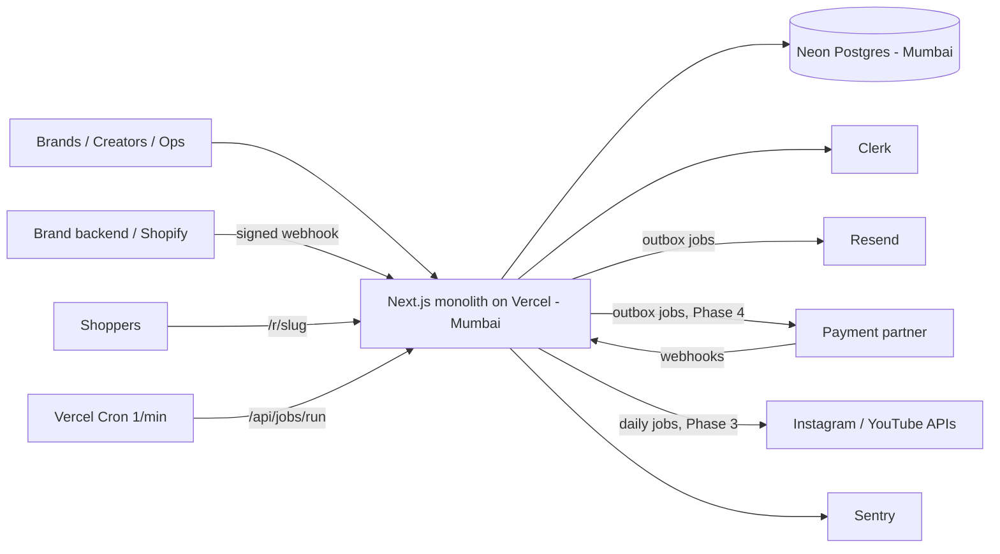

# proovd — Architecture

> Generated on 2026-11-05 | Moment: **validate → early grow** — working demo, preparing a closed beta with real brands and creators in India.
> Detailed flow audit and phased build plan: [`backend-plan.md`](./backend-plan.md).

## Summary
proovd is a single Next.js 15 + PostgreSQL monolith with a clean domain layer (compensation engine, state machines, double-entry ledger) and service functions that authorise every call by `Actor`. That core fits the next stage and should be kept. What's missing is everything at the edges: real auth, background jobs, managed Postgres, email, and real payment / social integrations, which today are mocked. The plan adds these in phases, starting with record-only payments so real deals can run before any regulated money movement.

**Assumed dimensions** (please correct): team of 1 + AI, closed beta ≤ 50 brands and ≤ 1,000 creators, infra budget ≤ $50/month excluding transaction fees, India only, fintech-adjacent compliance (money + personal data → DPDP, RBI PA rules via partner, TDS/GST).

## Alignment Score

```
📊 Architecture Alignment — validate → early-grow moment

  ✅ Next.js monolith (App Router, server actions)   — right size for 1 dev
  ✅ PostgreSQL + Drizzle + SQL migrations           — right; handles ledger, JSON, search at this scale
  ✅ Domain layer + Actor-based authorisation         — production-grade, keep
  ✅ Append-only ledger & audit (DB triggers)        — required for money; already done
  ✅ No Redis / queue / microservices                 — correctly absent
  ⚠️  PGlite as default DB                            — fine for demo, not for real users
  ⚠️  Migrations + seed run at app boot               — unsafe for production
  ⚠️  In-memory rate limiter                          — no effect on serverless
  ❌ Demo login (no real auth, no MFA)                — blocker for any real user
  ❌ No background jobs / retries                     — blocker for webhooks, payouts, social sync
  ❌ No CI                                            — blocker before money flows

  Alignment: 60% — strong core, edges not production-safe yet
```

## Architecture Diagram (ASCII)

```
                 ┌──────────────────────────── Vercel (Mumbai) ─────────────────────────────┐
 Brands ───────▶ │  Next.js app: pages, server actions, API routes                           │
 Creators ─────▶ │    src/app  →  src/server (services, Actor auth)  →  src/domain (pure)     │
 Ops ──────────▶ │                                                                           │
                 │  /api/v1/attribution/events  (signed brand webhook → 202, enqueue)        │
 Brand backend ─▶│  /api/webhooks/{payments,meta} (verify, store raw, enqueue)               │
 Shoppers ─────▶ │  /r/[slug]  tracked links                                                 │
                 │  /api/jobs/run  ◀── Vercel Cron (every minute) drains the jobs table       │
                 └───────────────┬──────────────────────────────┬────────────────────────────┘
                                 │ SQL (TLS)                     │ HTTPS (from jobs only)
                 ┌───────────────▼───────────────┐   ┌───────────▼────────────────────────────┐
                 │ Neon Postgres (Mumbai)        │   │ Clerk (auth, orgs, MFA)                 │
                 │ ledger · audit (append-only)  │   │ Resend (email)                          │
                 │ jobs · outbox · webhooks_raw  │   │ Payment partner (Phase 4, D4)           │
                 │ encrypted secrets & tokens    │   │ Instagram / YouTube APIs (Phase 3)      │
                 └───────────────────────────────┘   │ Sentry (errors)                         │
                                                     └─────────────────────────────────────────┘
```

## Architecture Diagram (Mermaid)



## Use Now

### Next.js 15 monolith (existing)
- **Role:** UI, server actions, API routes, webhook receivers, job runner endpoint.
- **Why now:** team of 1; one deployable unit; services already isolated from the UI.
- **When to replace:** split a separate API/worker service only when a second client (mobile app or public API) ships, or jobs exceed 5 min.

### PostgreSQL (Neon, Mumbai region) + Drizzle (existing ORM)
- **Role:** all data — ledger, audit, jobs, outbox, raw webhooks, search (pg_trgm).
- **Why now:** money needs transactions and constraints; one database is enough for ≤ 1k creators. Mumbai keeps latency low for Indian users.
- **When to replace:** add a read replica when report queries exceed 1 s p95; never add a second database type without a benchmark.

### Postgres job table + Vercel Cron
- **Role:** retries for webhooks, outbox delivery (email, payments), daily social sync, reminders, reconciliation.
- **Why now:** webhooks and payouts must be retried; a table with `FOR UPDATE SKIP LOCKED` needs no new infrastructure.
- **When to replace:** move to a long-running worker (Railway/Fly) when any job needs > 5 min or volume exceeds 10k jobs/day.

### Clerk (decision D2)
- **Role:** sign-up, sign-in, brand organisations and invites, MFA.
- **Why now:** handling money requires MFA for brand owners and ops from day one; building auth as a solo developer is the wrong risk.
- **When to replace:** at ~10k MAU if pricing hurts, migrate to Auth.js (users keyed by `auth_subject`, so migration is contained).

### Resend
- **Role:** transactional email through the outbox.
- **Why now:** offers, reviews and payouts need to reach people who aren't logged in.
- **When to replace:** add WhatsApp when creator email open rate < 30%.

### Sentry (free tier) + uptime check
- **Role:** error alerts, especially on money and webhook paths.
- **Why now:** real money and real users; silent failures are unacceptable.
- **When to replace:** add tracing when p95 latency is a problem.

## Add Later
- **Payment partner (Razorpay Route or Cashfree)** — add when: legal entity, CA advice on TDS/GST and partner use-case approval are done (Phase 4). Not now because: record-only payments (D1a) let the beta run without proovd holding funds.
- **Instagram API with Instagram Login + YouTube Analytics** — add when: Meta App Review and Google verification are granted (Phase 3). Not now because: approvals gate it; manual metrics stay labelled "Creator reported".
- **Object storage (Cloudflare R2)** — add when: > 30% of brands ask to review drafts before posting.
- **Dedicated worker** — add when: any job > 5 min or > 10k jobs/day.
- **Upstash Redis (rate limits only)** — add when: the Postgres limiter adds > 20 ms p95 to hot routes.
- **Meilisearch** — add when: > 10k creators/campaigns and discovery p95 > 500 ms.

## Don't Use Now
- **Redis for caching** — < 1k users; Postgres and HTTP caching are enough. Reconsider when DB CPU > 60% sustained.
- **Kafka / BullMQ / SQS** — a Postgres job table covers retries at beta volume. Reconsider at > 10k jobs/day.
- **Microservices / separate payments service** — one developer; every split adds deploys and failure modes. Reconsider at 3+ engineers or a second client.
- **In-house KYC or storing PAN / full bank numbers** — the payment partner holds KYC; we store only its account ids and last-4 digits. Reconsider never.
- **Separate analytics DB (ClickHouse/BigQuery)** — campaign reports run fine on Postgres at this size. Reconsider when reports slow the primary.
- **LLM-based matching** — matching is advisory and explainable today; add only with a labelled outcome dataset.

## Architecture Decision Records

### ADR-001: Keep the modular monolith
- **Choice:** One Next.js app with `domain/` (pure) → `server/` (services, Actor auth) → `app/` (UI, thin actions).
- **Why:** solo developer; the layering already gives testable seams.
- **Tradeoff:** jobs and web share deploys and limits.
- **Revisit when:** a second client ships or jobs exceed 5 min.

### ADR-002: Record-only payments before escrow
- **Choice:** Beta settlements are paid directly brand → creator and recorded with a UTR and two-sided confirmation; escrow/split comes later through a regulated partner.
- **Why:** proovd must not hold third-party funds without a partner and legal sign-off; this unlocks real usage in weeks.
- **Tradeoff:** no guarantee of payment yet; payment-delay disputes handled by ops.
- **Revisit when:** partner approval + CA advice are in hand (Phase 4).

### ADR-003: Every external call goes through the outbox / job table
- **Choice:** Write intent to the DB in the same transaction as the state change; a job performs the external call; results come back via webhook or polling and are applied idempotently.
- **Why:** today `payoutCreator` calls the provider before writing; a crash between the two loses the record.
- **Tradeoff:** actions become eventually consistent (seconds), so the UI shows "pending" states.
- **Revisit when:** never for money paths.

### ADR-004: Managed auth with organisations and MFA
- **Choice:** Clerk; `users.auth_subject` stores the provider id; `getActor()` is the only integration point.
- **Why:** fintech-adjacent product; MFA and team invites are table stakes.
- **Tradeoff:** vendor dependency and per-MAU pricing above the free tier.
- **Revisit when:** MAU > 10k or enterprise SSO is required.

### ADR-005: Data in India, PII separable from money records
- **Choice:** Vercel and Neon pinned to Mumbai; ledger and audit reference ids only; PII lives in `users`/`creator_profiles` and can be pseudonymised for DPDP erasure without breaking append-only tables.
- **Why:** DPDP obligations apply in full from ~May 2027; append-only money records can't be deleted.
- **Tradeoff:** erasure is pseudonymisation, documented in the privacy notice.
- **Revisit when:** legal advice changes.

### ADR-006: Separate demo, staging and production environments
- **Choice:** `APP_ENV` controls seed, demo login, reset and simulators; only `demo` has them.
- **Why:** seed currently runs on any empty DB and demo actions are always registered.
- **Tradeoff:** three environments to keep in sync (one codebase, env vars only).
- **Revisit when:** never.

## Cost Estimate
- **Monthly now (beta):** ~$20–45 — Vercel Pro $20 (Hobby is for non-commercial use and its cron is too infrequent), Neon free → $19 when storage/compute grows, Clerk free tier, Resend free tier, Sentry free tier, domain ~$1.
- **Monthly at next stage (~5k MAU, live payouts):** ~$80–200 + payment partner fees per transaction (~2% typical in India; confirm in contract).

### Cost Traps
- Vercel Pro is per seat ($20 per member) and charges for bandwidth beyond the included amount.
- Neon free tier limits storage and compute hours; the always-on job cron keeps compute awake — budget for the paid tier once live.
- Clerk and similar providers bill per MAU above the free tier; creators who sign up once and leave still count in that month.
- Payment partner fees apply to both collection and payouts; refunds may not return the fee.

## Agent Rules
- DO NOT add infrastructure that isn't solving a problem you have today.
- DO NOT add Redis, Kafka, BullMQ, or a second database without updating this document and an ADR.
- DO NOT call an external service (payments, email, social APIs) inside a request handler or a DB transaction; enqueue a job via the outbox instead.
- ALWAYS make money mutations idempotent (idempotency key) and atomic (one DB transaction), and post balanced ledger lines through `postLedger`.
- NEVER update or delete `ledger_entries`, `audit_events` or `attribution_events`; write compensating rows.
- NEVER store PAN, Aadhaar, full bank account numbers, card data or OAuth tokens in plain text; store partner ids, last-4 digits, and encrypted tokens only.
- ALWAYS authorise in `src/server` services through `Actor`; return "not found" for both missing and foreign records.
- ALWAYS gate demo-only behaviour (seed, demo login, reset, simulators, mock providers) behind `APP_ENV=demo`.
- DO NOT run migrations or seed at app boot outside local development; run them in the deploy pipeline.
- DO NOT mark a flow production-ready until its phase exit test in `docs/backend-plan.md` passes end to end.
- PREFER Postgres features (pg_trgm, JSONB, `SKIP LOCKED`) over new services.
- ALWAYS verify webhook signatures and store the raw payload before processing.

## Changelog
| Date | Reason | Changes |
|------|--------|---------|
| 2026-11-05 | Initial generation (brownfield review before moving from demo to beta) | — |

---
To update, run `/planfirst` again.
